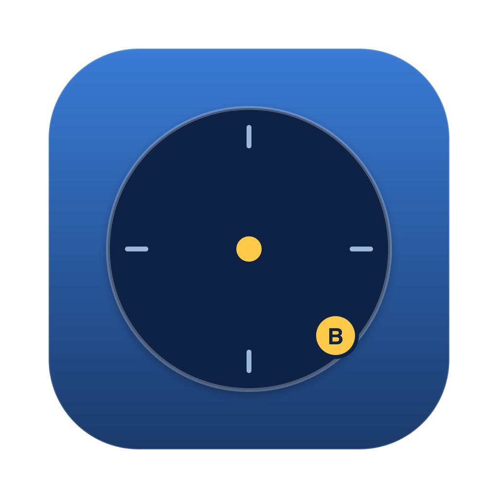
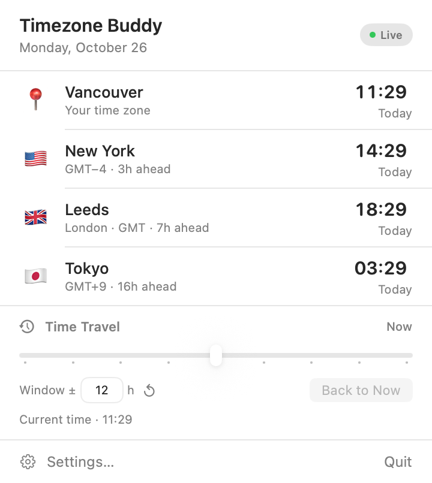
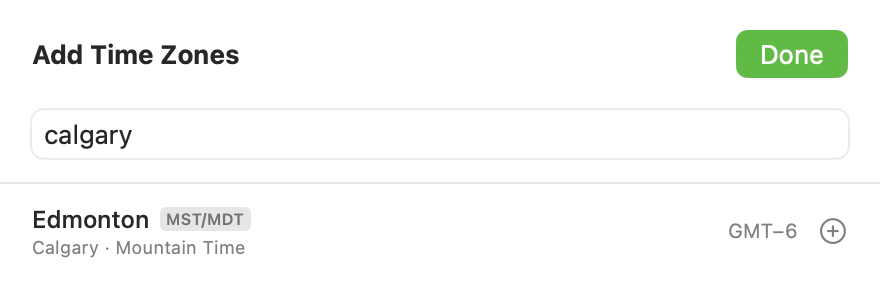

<p align="center">
  
</p>

<h1 align="center">Timezone Buddy</h1>

<p align="center">The time in the places you care about, one click away in the menu bar.</p>

<p align="center">
  <a href="https://github.com/eripa/timezone-buddy/actions/workflows/ci.yml"></a>
  <a href="https://github.com/eripa/timezone-buddy/actions/workflows/ci.yml"></a>
  <a href="LICENSE"></a>
</p>

<p align="center">
  
</p>

Timezone Buddy is a small macOS menu bar app for keeping an eye on other time
zones. Click the menu bar icon, get the time where the people you work with
are, and get on with your day.

## Features

- **Menu bar clocks.** Show a single clock icon that opens the panel, or put
  the enabled clocks directly in the menu bar.
- **Every zone, searchable by name.** 440+ zones, findable by city
  (`Edmonton`), region (`Argentina`), time zone name (`Mountain Time`), or
  abbreviation (`MST`, `EST`, `ET`). Cities that aren't reference cities still
  work: type `Calgary` and you get Edmonton, `Miami` and you get New York.
- **Rename any zone.** Show `London` as Leeds, or `Edmonton` as Calgary; the
  real city stays visible underneath the custom name.
- **Time travel.** Drag the slider to preview another moment. Every clock, day
  label and offset updates together, and the window is adjustable from ±1 to
  ±48 hours.
- **Editable clocks.** Click a time to type an exact 24-hour time — the other
  zones and the slider follow.
- **Per-zone emoji**, drag to reorder, launch at login, and an option to hide
  the Dock icon entirely.
- **About pane in Settings**, so version and build are reachable without the
  Dock icon.
- **Quiet and local.** No network access, no accounts, no analytics.

## Searching for a zone

The picker understands more than IANA identifiers. Searching for `calgary`
finds Edmonton, because that is the reference city that covers it — the same
trick that turns `Miami` into New York and `Leeds` into London.

<p align="center">
  
</p>

Search matches are ranked, so `EST` puts New York first rather than whichever
Eastern zone sorts alphabetically, and time zone names like "Mountain" or
"Atlantic" work without knowing a single city.

## Requirements

- macOS 27.0 or later
- Apple silicon

## Install

Download the latest `Timezone Buddy-x.y.zip` from
[Releases](../../releases), unzip it and move **Timezone Buddy.app** to your
Applications folder. No release attached yet? Build it from source below.

Each release also publishes a `.sha256` checksum. Verify the download before
opening it:

```sh
shasum -a 256 -c "Timezone Buddy-x.y.zip.sha256"
```

The build is signed ad-hoc rather than notarized, so macOS will refuse the
first launch. Use **right-click → Open** once, or clear the quarantine flag:

```sh
xattr -d com.apple.quarantine "/Applications/Timezone Buddy.app"
```

## Building from source

Requires Xcode 27 or later. From the repository root:

```sh
xcodebuild -project timezone-buddy.xcodeproj -scheme timezone-buddy \
  -configuration Release -destination 'generic/platform=macOS' \
  -derivedDataPath build build

open "build/Build/Products/Release/Timezone Buddy.app"
```

Or open `timezone-buddy.xcodeproj` in Xcode and press Run.

### Running tests

The Swift Testing suite covers the models and formatting, and a UI smoke test
opens the menu bar panel and Settings window:

```sh
xcodebuild test -project timezone-buddy.xcodeproj -scheme timezone-buddy \
  -destination 'platform=macOS'
```

Current app-target line coverage is **55.85%** at 1.5.0 (1,629/2,917 lines).
The CI workflow runs the suite with coverage enabled, publishes the full report
as an artifact, posts a summary on same-repository pull requests, and writes the
same summary to the job page. The badge is a release snapshot; CI is the current
source of truth.

## Using it

| I want to… | Where |
| --- | --- |
| Open the panel | Click the menu bar icon |
| Add a zone | Settings → Time Zones → **Add Time Zone** |
| Rename a zone | Settings → Time Zones: click its name and type |
| Reorder zones | Drag the six-dot handle at the left of a row |
| Change menu bar style, launch at login, Dock icon | Settings → General |
| Preview another time | Drag the **Time Travel** slider, or click a clock and type |

## Project layout

| Path | What it does |
| --- | --- |
| `timezone-buddy/MyApp.swift` | Entry point, menu bar extra and Settings lifecycle |
| `timezone-buddy/MenuBarScene.swift` | Menu bar label and the drop-down panel |
| `timezone-buddy/AddTimeZoneView.swift` | The searchable zone picker |
| `timezone-buddy/TimeModels.swift` | Clock, time travel, and the searchable zone index |
| `timezone-buddy/TimeFormatting.swift` | Localized time, day and offset formatting |
| `timezone-buddy/AppSettings.swift` | Persisted zones and preferences |
| `timezone-buddy/SettingsView.swift` | Preferences window, including About |
| `timezone-buddy/SettingsWindowController.swift` | AppKit host for the Settings window |
| `timezone-buddy/LaunchAtLogin.swift` | Login item handling |
| `timezone-buddy/Localizable.xcstrings` | String Catalog for user-facing text |
| `timezone-buddy/PrivacyInfo.xcprivacy` | Privacy manifest |
| `timezone-buddyTests/` | Swift Testing unit tests |
| `timezone-buddyUITests/` | XCUIAutomation menu bar and Settings smoke test |

Zone names and abbreviations come from the system's time zone database. The
hand-written aliases that make `Calgary` and `Florida` work live in
`ZoneCuration` at the bottom of `TimeModels.swift`.

## Privacy

Timezone Buddy makes no network requests and collects nothing. Your zone list
and preferences are stored in `UserDefaults` on your Mac. The bundled
`PrivacyInfo.xcprivacy` declares that use.

## Localization

User-facing strings live in `timezone-buddy/Localizable.xcstrings`. German is
included; add more languages in Xcode's String Catalog editor. Translations use
stable keys and the English source strings.

## Contributing

Contributions are welcome. Read [CONTRIBUTING.md](CONTRIBUTING.md) and
[CODE_OF_CONDUCT.md](CODE_OF_CONDUCT.md) before opening a pull request. For
security-sensitive reports, use [SECURITY.md](SECURITY.md) rather than a public
issue. Release history is in [CHANGELOG.md](CHANGELOG.md).

## License

Timezone Buddy is free software: you can redistribute it and/or modify it
under the terms of the GNU General Public License as published by the Free
Software Foundation, either version 3 of the License, or (at your option) any
later version.

Timezone Buddy is distributed in the hope that it will be useful, but WITHOUT
ANY WARRANTY; without even the implied warranty of MERCHANTABILITY or FITNESS
FOR A PARTICULAR PURPOSE. See the [GNU General Public License](LICENSE) for
more details.

---

© 2026 ripa.io. Timezone Buddy is licensed under GPL-3.0-or-later.
